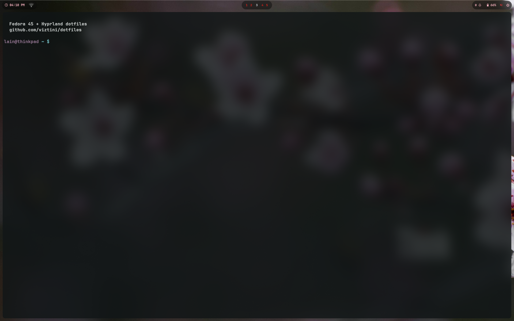

# Fedora ThinkPad Hyprland Dotfiles

A public-ready dotfiles collection and desktop rice for **Fedora 45 + Hyprland 0.57** on a ThinkPad.

Based on [`binnewbs/arch-hyprland`](https://github.com/binnewbs/arch-hyprland), adapted for Fedora, with TrackPoint/touchpad tuning, ThinkPad media keys, a cherry-blossom + TrackPoint-red palette, and a lighter startup.

## Screenshots

Captured at 1920x1200 on workspace 3.

### Terminal open



### Empty workspace


### Lock screen


## Highlights

- Hyprland **0.57 Lua** config; classic `.conf` files are kept for reference
- Waybar, Rofi, Kitty, swaync, wlogout, matugen, fastfetch, cava
- ThinkPad media keys, TrackPoint/touchpad settings, natural scrolling, gestures
- Cherry-blossom pink + TrackPoint red palette
- Ly TUI display manager on `tty2` (no SDDM)
- Fingerprint-capable PAM via `authselect with-fingerprint`
- TLP/TLP-PD power management; battery charge thresholds **75/80**
- 59 wallpapers included in `wallpapers/`
- Delayed non-essential autostart for a faster initial load

## Repository layout

```text
shell/        shell dotfiles (.zshrc, .zprofile, .bashrc, .bashrc.d, ...)
config/       ~/.config contents for the rice and desktop apps
wallpapers/   wallpaper library
screenshots/  preview images used in this README
system/       reference copies of system-level configs (not installed automatically)
install.sh    symlink installer with backup support
```

## Install

Clone and install:

```bash
git clone https://github.com/viztini/dotfiles.git ~/dotfiles
cd ~/dotfiles
./install.sh
```

`install.sh` symlinks the dotfiles into `$HOME` and `$HOME/.config`. Existing files are moved to `~/.dotfiles-backup/<timestamp>/` before linking.

Skip the wallpaper symlink if you already manage `~/Pictures/wallpapers`:

```bash
./install.sh --no-wallpapers
```

Log out and back in (or reboot) after installing.

## Dependencies

Key packages used by this setup:

```bash
sudo dnf copr enable nett00n/hyprland
sudo dnf copr enable heus-sueh/packages
sudo dnf install hyprland hyprlock hypridle waybar swww swaync rofi kitty \
  nautilus ranger matugen fastfetch wlogout pipewire wireplumber \
  playerctl brightnessctl grim slurp hyprpicker ly fprintd tlp tlp-pd zsh
```

Oh My Zsh and the JetBrains Mono Nerd Font are installed separately. Any Nerd Font with the required glyphs should work.

## Fedora / ThinkPad notes

- Display manager: `ly@tty2.service` is enabled; SDDM is not installed.
- Fingerprint: enroll with `fprintd-enroll`. PAM is configured with `pam_fprintd.so` for Ly and hyprlock where supported.
- Battery: `system/thinkpad-battery-thresholds.service` is a reference copy of the active 75/80 threshold service.
- Power: TLP and TLP-PD are enabled; tuned is intentionally not used because they conflict.
- Startup: Waybar, wallpaper, and the polkit agent start immediately; `nm-applet`, `swaync`, and `hypridle` are deferred by 3–5 seconds.

## Not included

For safety and size, this repo intentionally excludes:

- shell history (`.zsh_history`, `.bash_history`)
- browser profiles and mail/KDE account data
- SSH keys, tokens, certificates, and private keys
- `.local/share` app data, caches, logs, and zsh completion dumps
- old setup/backup directories from the original machine

Wallpapers and preview screenshots are included intentionally.
